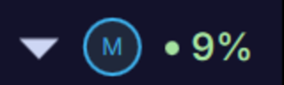
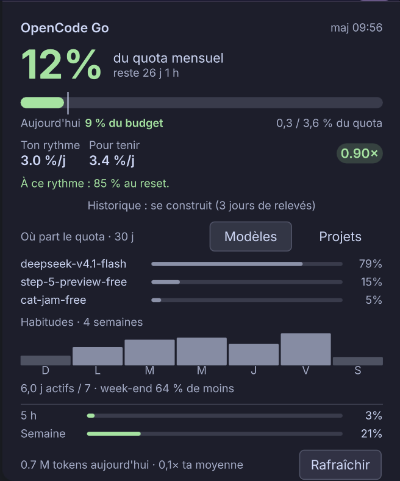

# OpenCode Meter

Widget KDE Plasma 6 pour suivre ton quota **OpenCode Go** et tenir jusqu'au reset.

La pilule du panneau affiche la part du **budget du jour** déjà consommée. Un clic
ouvre le détail : quota mensuel, projection de fin de mois, répartition par modèle
et par projet, profil hebdomadaire.





## Ce que ça fait

- **Pilule** : `9%` = part du budget du jour utilisée. `100 %` signifie que tu es
  pile dans les temps. Vert sous 90 %, ambre de 90 à 115 %, rouge au-delà.
- **Quota réel** : interroge l'API OpenCode Go (fenêtres 5 h, semaine, mois) avec
  les vrais pourcentages et les vrais resets.
- **Budget du jour** : le quota restant est réparti sur les jours qui restent, en
  tenant compte de tes habitudes (semaine plus chargée que le week-end).
- **Projection** : estime le pourcentage atteint au reset, ou la date de saturation
  si ton rythme actuel ne tient pas.
- **Où part le quota** : répartition des tokens sur 30 jours, par modèle ou par
  projet (les worktrees T3 sont regroupés avec leur projet).
- **Profil** : consommation moyenne par jour de semaine, nombre de jours actifs,
  écart week-end.
- **Notifications** : une alerte KDE par jour maximum si ton rythme dépasse le
  budget soutenable.
- **CLI** : `opencode-meter` affiche les mêmes données dans le terminal.

## Prérequis

- KDE Plasma 6 (testé sur 6.8, Wayland)
- Python 3.11 ou plus
- `systemd --user`, `kpackagetool6`, `notify-send`
- OpenCode configuré avec un compte `opencode-go`
  (clé dans `~/.local/share/opencode/account.json`)

## Installation

```bash
git clone https://github.com/MattiaPARRINELLO/opencode-meter.git
cd opencode-meter
./install.sh
```

Le script installe le collecteur dans `~/.local/lib/opencode-meter`, crée la
commande `~/.local/bin/opencode-meter`, active un timer systemd utilisateur
(relevé toutes les 10 minutes) et installe le plasmoid.

Pour finir : clic droit sur le panneau, **Ajouter des widgets**, puis
**OpenCode Meter**.

## Utilisation

```bash
opencode-meter            # tableau lisible
opencode-meter --json     # JSON complet
opencode-meter --notify   # relevé + notification éventuelle
```

Le widget se rafraîchit seul. Le bouton **Rafraîchir** du popup force un relevé
immédiat.

## Comment le calcul fonctionne

| Grandeur | Formule |
|---|---|
| rythme observé | écart de pourcentage entre deux relevés de la fenêtre courante (si au moins 6 h d'historique) |
| rythme moyen | pourcentage consommé divisé par les jours écoulés |
| rythme soutenable | pourcentage restant divisé par les jours restants |
| profil hebdomadaire | moyenne de tokens par jour de semaine sur 28 jours, normalisée (1 = journée moyenne) |
| projection pondérée | pourcentage consommé divisé par les jours pondérés écoulés, multiplié par les jours pondérés restants |
| budget du jour | pourcentage restant divisé par les jours pondérés restants, multiplié par le facteur du jour |
| consommation du jour | tokens OpenCode Go du jour multipliés par le ratio pourcentage/tokens de la fenêtre |
| ratio du jour | consommation du jour divisée par le budget du jour |

Le début de chaque fenêtre est déduit du reset : moins 5 h pour la fenêtre 5 h,
moins 7 jours pour la semaine, moins un mois calendaire pour le mois. Sous 5 h
restantes, le rythme soutenable n'est pas affiché (il tend vers l'infini).

Quand 14 jours de données locales existent, la projection n'est plus linéaire :
chaque jour restant est pondéré par ton profil (un samedi creux compte moins qu'un
mardi chargé). Le champ `projection_source` passe alors à `habitudes`.

## Données et vie privée

Tout reste en local :

```
~/.cache/opencode-meter/usage.json       état lu par le widget
~/.cache/opencode-meter/history.sqlite   relevés, pour la courbe
~/.local/share/opencode/opencode.db      lu en lecture seule (tokens)
```

La clé API est lue depuis `account.json` (ou `OPENCODE_GO_API_KEY` si définie).
Elle n'est jamais écrite dans un log ni recopiée dans `usage.json`.

Seule requête réseau : un `GET https://opencode.ai/zen/go/v1/usage` toutes les
10 minutes, avec la clé en en-tête Authorization.

## Limites connues

- L'API de quota ne fournit pas d'historique : la courbe se remplit à partir du
  premier relevé (affichée après 3 jours de données).
- Le quota est exprimé en pourcentage, pas en tokens. Les tokens locaux servent
  d'indicateur d'activité et de base aux projections, pas de conversion exacte.
- L'endpoint `opencode.ai/zen/go/v1/usage` n'est pas documenté publiquement. S'il
  change, le widget affiche l'erreur et conserve les dernières données connues.

## Désinstallation

```bash
./uninstall.sh
```

Les données restent dans `~/.cache/opencode-meter`. Supprime le dossier pour tout
effacer.

## Licence

MIT, voir [LICENSE](LICENSE).

## Crédits

Code écrit par un assistant IA (OpenCode, DeepSeek V4.1 Flash), testé et validé sur
la machine de l'auteur.
